<div align="center">



<h1>astar-lab · آزمایشگاه جست‌وجو</h1>

<p>آزمایشگاه تعاملی و سه‌بعدی برای اجرا، بازپخش گام‌به‌گام و مقایسه الگوریتم‌های جست‌وجو در فضای حالت</p>

<p>
  <a href="LICENSE"></a>
  <a href="package.json"></a>
  <a href="package.json"></a>
  <a href="package.json"></a>
  <a href="vite.config.ts"></a>
</p>

<p>
  <a href="#شروع-سریع">شروع سریع</a> ·
  <a href="#ارتباط-با-گزارش-پژوهشی">گزارش پژوهشی</a> ·
  <a href="#ویژگی‌ها">ویژگی‌ها</a> ·
  <a href="#مشارکت">مشارکت</a>
</p>

</div>

---

<div dir="rtl">

## چرا این پروژه؟

درک رفتار الگوریتم‌های جست‌وجو تنها با خواندن شبه‌کد ساده نیست؛ تفاوت‌هایی مانند ترتیب گسترش گره‌ها، بازگشایی حالت‌های بهبودیافته یا تاثیر تابع تخمین (`heuristic`) در عمل بهتر دیده می‌شوند. `astar-lab` محیطی تحت وب فراهم می‌کند تا الگوریتم‌های جست‌وجوی آگاهانه و ناآگاهانه را روی مسائل استاندارد اجرا کنید، خط زمانی اجرا را گام‌به‌گام ببینید و خروجی آن‌ها را با معیارهای عددی مقایسه کنید.

## ارتباط با گزارش پژوهشی

این مخزن بخش عملی و آزمایشگاهی یک ارائه دانشگاهی و گزارش پژوهشی درباره الگوریتم جست‌وجوی **A\*** است. `astar-lab` به‌طور مشخص در پیوند با **فصل هشتم** گزارش توسعه یافته و برای طراحی، اجرا و نمایش آزمایش‌های عملی آن فصل به کار می‌رود؛ از جمله مسئله **پازل ۸تایی (8-Puzzle)** و **مسیریابی در ماز (Maze)**.

این پروژه صرفاً کد و ابزار آزمایشی همراه گزارش است و کل متن گزارش پژوهشی را در بر نمی‌گیرد.

## ویژگی‌ها

- **شش الگوریتم جست‌وجو:** پیاده‌سازی `A*`، `Dijkstra`، `Greedy`، `BFS`، `DFS` و `IDA*` با ثبت کامل رخدادهای جست‌وجو (`push`، `pop`، `expand`، `relax` و غیره).
- **سه محیط آزمایش:**
  - **ماز (Maze):** شبکه قابل ویرایش از `2×2` تا `100×100`، پشتیبانی از حرکت مورب (با هزینه `√2` و تخمین Octile در برابر Manhattan)، تولید تصادفی با بذر (`seed`) مشخص و تعیین ترتیب همسایه‌ها.
  - **پازل ۸تایی (8-Puzzle):** بررسی خودکار حل‌پذیری از طریق زوجیت جایگشت (`parity`)، محاسبه فاصله منهتن و به‌هم‌ریختن کنترل‌شده با تعداد حرکت و بذر مشخص.
  - **گراف (Graph):** گراف‌های جهت‌دار و بی‌جهت تا ۲۰۰ گره و ۲۰۰۰ یال با انتخاب تخمین `zero`، `euclidean`، `manhattan` یا مقادیر دلخواه (`custom`) و بررسی مجاز بودن و سازگاری تخمین.
- **اجرای غیرهمگام و بازپخش گام‌به‌گام:** اجرای جست‌وجو در Web Worker بدون قفل شدن رابط کاربری، همراه با کنترل پخش، توقف، تغییر سرعت و نمایش درخت جست‌وجو.
- **نمای سه‌بعدی تعاملی:** نمایش وضعیت شروع، هدف، دیوارها، مرز (`frontier`)، گره‌های گسترش‌یافته و مسیر نهایی با Three.js.
- **تحلیل، مقایسه و خروجی:** مقایسه آزمایش‌های هم‌ارز، بررسی تطابق با مقادیر مرجع برای حالت‌های پیش‌فرض ماز و پازل، ذخیره آزمایش‌ها در `IndexedDB` مرورگر و خروجی به قالب‌های `JSON`، `CSV` و `PDF`.
- **رابط دوزبانه و بخش آموزشی:** پشتیبانی از فارسی (پیش‌فرض، راست‌به‌چپ با فونت وزیرمتن) و انگلیسی، پوسته روشن/تیره/سیستم و درس‌نامه و تمرین‌های تعاملی درون برنامه.

## شروع سریع

برای اجرای محلی پروژه به Node.js و npm نیاز دارید:

```bash
git clone https://github.com/itsnyxdev/astar-lab.git
cd astar-lab
npm install
npm run dev
```

پس از اجرای دستور بالا، آدرس محلی نمایش‌داده‌شده در ترمینال (معمولاً `http://127.0.0.1:5173`) را در مرورگر باز کنید.

برای اجرای بررسی تایپ‌ها، آزمون‌های واحد و ساخت نسخه نهایی:

```bash
npm run typecheck
npm test
npm run build
```

## اسکریپت‌ها و گزینه‌های پیکربندی

### اسکریپت‌های `npm`

| دستور | عملکرد |
| --- | --- |
| `npm run dev` | اجرای سرور توسعه Vite روی `127.0.0.1` |
| `npm run build` | بررسی تایپ‌های TypeScript و ساخت خروجی نهایی در `dist/` |
| `npm run typecheck` | اجرای `tsc -b` بدون تولید فایل |
| `npm test` | اجرای آزمون‌های واحد با Vitest |
| `npm run test:watch` | اجرای Vitest در حالت پایش مداوم |
| `npm run test:e2e` | اجرای آزمون‌های سرتاسری با Playwright |

<details>
<summary>محدودیت‌های پیش‌فرض اجرا و پیکربندی محیط</summary>

در `src/engine/types.ts` برای جلوگیری از مصرف بیش‌ازحد منابع مرورگر، محدودیت‌های پیش‌فرض زیر (`defaultLimits`) تعریف شده است:

| گزینه | مقدار پیش‌فرض | توضیح |
| --- | --- | --- |
| `expanded` | `100000` | بیشینه تعداد گره‌های گسترش‌یافته |
| `generated` | `250000` | بیشینه تعداد گره‌های تولیدشده |
| `events` | `1000000` | بیشینه تعداد رخدادهای ثبت‌شده در رد اجرا |
| `durationMs` | `30000` | بیشینه زمان اجرای جست‌وجو (میلی‌ثانیه) |

همچنین پیکربندی پیش‌فرض آغازین (`initialConfig` در `src/environments/index.ts`) با محیط `maze`، الگوریتم `astar`، بذر `"search-lab"`، `shuffleMoves: 24` و `zeroHeuristic: false` مقداردهی می‌شود. برای استقرار ایستا روی Cloudflare Workers نیز فایل `wrangler.jsonc` مسیر خروجی `./dist` را در حالت `single-page-application` معرفی می‌کند.

</details>

## ساختار پروژه

```text
astar-lab/
├── assets/               # بنرهای SVG پروژه
├── e2e/                  # آزمون‌های سرتاسری Playwright
├── public/fonts/         # فونت Vazirmatn و مجوز OFL
├── src/
│   ├── analytics/        # مقایسه آزمایش‌ها و تطابق با مقادیر مرجع
│   ├── app/              # رابط اصلی برنامه و مدیریت وضعیت
│   ├── components/       # ویرایشگر مسئله، نمودار/جدول تحلیل و درس‌نامه
│   ├── engine/           # پیاده‌سازی الگوریتم‌ها، هیپ دودویی و آزمون‌های واحد
│   ├── environments/     # تعریف و اعتبارسنجی ماز، پازل ۸تایی و گراف
│   ├── i18n/             # متن‌های فارسی و انگلیسی
│   ├── playback/         # خط زمانی بازپخش گام‌به‌گام رخدادها
│   ├── services/         # ذخیره‌سازی (IndexedDB/localStorage) و خروجی JSON/CSV/PDF
│   ├── visualization/    # صحنه سه‌بعدی Three.js / React Three Fiber
│   └── workers/          # Web Worker اجرای غیرهمگام جست‌وجو
├── index.html
├── package.json
├── playwright.config.ts
├── vite.config.ts
└── wrangler.jsonc
```

## مشارکت

برای گزارش خطا یا پیشنهاد بهبود، می‌توانید یک Issue باز کنید یا تغییرات خود را در قالب Pull Request بفرستید. پیش از ارسال تغییر، مطمئن شوید دستورات زیر بدون خطا اجرا می‌شوند:

```bash
npm run typecheck
npm test
```

<!-- TODO: در صورت نیاز به راهنمای دقیق‌تر برای نام‌گذاری شاخه‌ها یا سبک commit، آن را به این بخش اضافه کنید. -->

## مجوز

این پروژه تحت مجوز [MIT](LICENSE) منتشر شده است.

</div>
